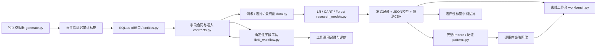

# 阿基米达风险决策实验室

**Archimeda Risk Lab**

**用独立合成支付实验，研究风险信号、完整规则与决策证据。**

Independent risk decision research, with reproducible synthetic evidence and explicit limits.

Lab把通用风险分析、算法建模、Pattern研究、策略设计与字段治理能力重新实现为可复核的公开实验：帮助作者深化方法，让招聘者看懂贡献，让面试官能运行代码、改变输入并质疑结论。研究围绕同一长期问题链增量积累。

独立模拟数据和代码；不含企业资料。软件版本 **0.3.0rc1**（公开预发布）。正式公开仓库：[archimeda-risk-lab](https://github.com/ArchimeDAs0612/archimeda-risk-lab) · **[在线静态 Demo](https://archimedas0612.github.io/archimeda-risk-lab/)** · [公开交付记录](docs/PUBLICATION_STATUS.md)。

[](https://github.com/ArchimeDAs0612/archimeda-risk-lab/actions/workflows/check.yml)
[](https://scorecard.dev/viewer/?uri=github.com/ArchimeDAs0612/archimeda-risk-lab)

**直接演示：** [真实研究入口](demo/index.html) · [交互研究工作台](artifacts/rc1/research/normal/index.html) · [选择性标签实验](artifacts/rc1/label-visibility/index.html) · [审计与修复](docs/RC1_AUDIT.md) · [5分钟技术演示](docs/INTERVIEW_GUIDE.md)。在线Demo可直接操作；GitHub文件源码预览不会执行HTML。克隆或下载后也可离线打开，核心演示无需外部服务。

## 关键贡献

1. **把时点与粒度变成可测试的数据合同。** 多事件支付与多实体关系、SQL历史窗口、Rej→Pass配对和训练内案例几何贯通；72h配对26个中15个跨订单，因此“后来成功”不能直接充当误杀标签。[数据实现](risklab/entities.py) · [SQL](risklab/entity_windows.sql) · [实际案例结果](artifacts/rc1/research/normal/result.json) · [时钟反例](tests/test_simulator_invariants.py)。
2. **用公平输入对照保留负结果。** LR/CART/同容量森林的15组比较区分训练、选择、最终评价，保存可独立推理的JSON模型。主Raw forest AP0.2044，高于Score LR0.1298；同容量新增字段森林反而下降0.0276，不能宣传宽字段必然增益。[模型实现](risklab/research_models.py) · [设计](docs/RC1_STUDY_PLAN.json) · [结果](docs/RC1_RESULTS.md)。
3. **将候选发现推进到完整条件与动作证据。** 冻结完整树路径、逐成员复算、独立后续窗、金额/来源反证、简化敏感性和策略回放连通；正富集与不稳定同时保留，另一种子候选验证失败。[Pattern实现](risklab/patterns.py) · [冻结记录](artifacts/rc1/research/normal/frozen_selection.json) · [独立核验](scripts/verify_v02.py)。
4. **显式研究不可观察标签，而不误用子集指标。** 固定模型的四种可见机制给出总体Recall识别边界；仅观察成功支付时区间为[0.1500,0.4103]，无法拿子集0.3285替代。[实现](risklab/label_visibility.py) · [实际结果](artifacts/rc1/label-visibility/result.json)。
5. **让字段治理约束真实工具执行。** 结构化路径、版本、禁用、冲突与证据失效连接下游准入；工具工作流实际18次调用、28项检查，保留未知工具失败和恢复，准确区分确定性工具与尚未实现的LLM Agent。[治理](risklab/field_intelligence.py) · [调用记录](artifacts/rc1/field-tools/transcript.json) · [失败评估](artifacts/rc1/field-tools/evaluation.json)。

## 已验证能力与边界

| 能力 | 已实现与实际证据 | 仍不能声称 |
| --- | --- | --- |
| 数据工程 | 多事件订单、账户/设备/工具关系；SQLite 1h/24h/7d as-of 窗口；异常准入和案例画像 | 企业数据代表性、真实拒付标签 |
| 模型 | LR、CART、同容量森林；15种输入比较；train/select/final隔离；保存JSON模型并独立推理 | 随机种子复现等同真实域泛化；消融等同因果贡献 |
| Pattern | 完整叶路径、冻结候选、float32逐成员回放、独立后续窗、反证和失败保留 | 稳定发现、生产规则有效性、重新挑测试最佳候选 |
| 策略 | AND/OR/审核/拒绝逐事件动作模拟与成本算术 | 真实业务收益、行为响应、因果收益 |
| 字段与工具 | 禁用/冲突/版本/证据漂移传播；真实工具调用摘要链；未知工具失败恢复与评估 | LLM Agent、自主语言规划、已认证审核身份 |
| 复现与展示 | 离线交互；新虚拟环境与安装包在源码外执行；独立指标与回放复算 | 未运行的操作系统或远程CI也通过 |

## 研究地图与实际架构

数据与字段理解 → 案例分析 → 模型与信号增益 → Pattern研究 → 策略模拟 → 字段工具与可复现交付。以下为已实现连接，真实LLM、外部域验证与生产监控属于后续研究。



图中每个节点对应实际模块与保存产物，不包含规划中的服务。

## 中文研究专题

| 专题 | 问题、方法与代表成果 | 深入入口 |
| --- | --- | --- |
| 支付拒绝与后续行为复盘 | 用SQL定义最早后续成功；区分尝试、订单与用户；1/6/24/72h配对11/12/18/26，训练内四簇仅描述几何 | [问题、案例、代码、练习](studies/payment-cases.md) |
| 风险策略条件与决策回放 | 区分同事件联合、历史并集与动作；完整路径90次命中经逐成员验证；OR拒绝与审核的代价不同 | [回放与反例](studies/strategy-replay.md) |
| 宽特征建模与 Pattern 验证 | 公平基线、输入消融、冻结选择与时间外评价；新增字段负增益、重新发现不稳定和独立失败案例完整保留 | [模型设计与结论](studies/models-patterns.md) |
| 支付风控字段资产治理 | 类型/路径/来源/对象/窗口与语义审核分离；禁用、碰撞、版本变化和证据漂移能阻断下游 | [治理方法与失败](studies/field-governance.md) |
| 字段智能工作流与 Agent 研究 | 白名单工具真实调用、结构化证据和错误恢复；8场景检查，当前没有LLM调用 | [工作流与评估](studies/field-workflow.md) |

[专题总入口](studies/README.md)连接同一代码与证据；不为每个专题复制训练管线。每篇解释输入假设、选择方法的原因、支持边界及本人练习。

## 完整案例：从信号比较到候选反证与策略模拟

预先登记 [RC1研究设计](docs/RC1_STUDY_PLAN.json)，修正物理设备年龄一致性后，主实验仍为 7000订单、9577次尝试，训练/选择/最终为 5133/1364/1968。最终窗有162个风险标签。原V0.2结果保留为历史，不与新生成机制混作一次实验。

关键评价口径：AP采用average precision，ROC-AUC/KS评价排序区分，Lift@10%为最终窗最高分10%风险率相对全窗风险率。正例162/1968；区间按用户簇bootstrap，不是生产置信保证。

| 主实验模型 | 最终 AP | ROC-AUC | KS | Lift@10% |
| --- | ---: | ---: | ---: | ---: |
| Score LR | 0.1298 | 0.6107 | 0.2006 | 1.4800 |
| Raw LR | 0.1654 | 0.6909 | 0.3114 | 2.5833 |
| Raw forest（选择窗选中） | 0.2044 | 0.6911 | 0.3001 | 3.3299 |

选中森林相对Score LR的最终AP差为0.0747，用户簇区间[0.0297,0.1315]。这是此模拟器后续时间窗中的证据。另两个预登记种子选中不同模型，不能据最终AP重新选择主模型。**同容量新增特征森林相对Raw forest的AP差为−0.0276，未证明新增字段改善。** 15模型的探索性区间没有提供整体多重检验校正。

冻结候选 `raw_tree:11` 完整条件绑定训练填补、缺失指示和float32域：`device_age_days > 0.43503323197364807` AND `device_age_days <= 10.210319519042969` AND `geo_distance > 0.13304689526557922` AND `auth_strength > 0.5`。最终90次覆盖、18个风险、风险率20%；相对其余事件的差值区间[0.0127,0.1985]，仅支持调查。三个训练重采样重新发现的Jaccard均为0，**不能声称Pattern稳定**。种子20261018的冻结候选独立验证失败，保留 `INSUFFICIENT_SUPPORT`。

OR拒绝回放使模拟拒绝从9变为99，额外拒绝72个风险零事件；模型化成本9002.63→8122.62依赖拒绝防止全部风险金额损失等强假设，不是业务收益。仅观察成功支付时，全部尝试的Recall只能识别在[0.1500,0.4103]；子集Recall 0.3285不能直接替代它。[完整结果与失败案例](docs/RC1_RESULTS.md)。

## Demo、五分钟演示与复现

[在线静态Demo](https://archimedas0612.github.io/archimeda-risk-lab/)提供预生成真实结果；[交互工作台](https://archimedas0612.github.io/archimeda-risk-lab/artifacts/rc1/research/normal/index.html)可检索事件、比较模型、修改规则并在浏览器重算覆盖/动作。它没有在线训练、Python后端或实时Agent。

五分钟顺序：**0–1分**看支付案例和as-of窗口；**1–2分**比较基线及负增益；**2–3分**查看完整候选和失败种子；**3–4分**改变OR/AND/审核并核对事件；**4–5分**查看字段失败恢复与标签识别边界。[详细路线与追问](docs/INTERVIEW_GUIDE.md)。新实验和字段工具执行使用下面的本地Python命令。

本地实测CPython3.9.6 / macOS arm64，真实GitHub Actions另验收Ubuntu24.04的Python3.9与3.11。其他环境及跨平台逐比特一致性未声称。免费依赖安装后，实验和工作台可离线运行。

```sh
python3 -m venv .venv
.venv/bin/python -m pip install -r requirements-lock.txt
.venv/bin/python -m pip install .
.venv/bin/python -W error -m unittest discover -s tests -v
.venv/bin/python -W error -m risklab generate --out runs/data
.venv/bin/python -W error -m risklab run --data runs/data --out runs/legacy
.venv/bin/python -W error -m risklab research-demo --out runs/research
.venv/bin/python scripts/verify_v02.py runs/research/normal
.venv/bin/python -m risklab label-study --data runs/research/normal --out runs/visibility
.venv/bin/python -m risklab field-workflow --data runs/research/normal --out runs/field-tools
.venv/bin/python -m risklab predict --model runs/research/normal/models/raw_forest.json --data runs/research/normal/samples.csv --out runs/inference
```

输出目录必须不存在或为空。自行打开 `runs/research/normal/index.html`；11个正常、异常和修复分支索引为 `runs/research/index.html`。安装包包含默认配置、SQL和工作台资源，在源码目录之外也可使用默认命令。[真实复现记录](docs/RC1_REPRODUCTION.json)。

字段工具另提供 `field-inventory`、`field-change`、`field-review`；新释义保持待人工审核。已保存的JSON模型仅支持本Lab的二分类LR/CART/森林，不是通用模型格式，不执行pickle。`predict`不代表线上模型服务或字段治理授权。

## 工程目录与深入阅读

| 入口 | 作用 |
| --- | --- |
| [studies/](studies/README.md) | 中文问题、方法、证据与练习，面向研究阅读 |
| [risklab/](risklab) / [config/](config) | 同一套生成、SQL、模型、Pattern、治理与工作台实现及配置 |
| [scripts/](scripts) / [tests/](tests) | 独立指标/路径复算、公开候选/站点、安全核验与行为反例 |
| [artifacts/rc1/](artifacts/rc1) | 保存的JSON模型、预测CSV、冻结过程、完整与失败实验 |
| [docs/](docs) | 方法、统一结果、审计、复现记录及技术追问；旧阶段记录保留历史 |
| [CHECKPOINT](CHECKPOINT.md) / [AGENTS](AGENTS.md) | 唯一主要待办与维护规则，分别维护进度和执行约定 |

## 来源、贡献与适用边界

项目原名Risk Decision Lab，现使用作者个人标识Archimeda（阿基米达）。仓库更名沿用同一Git历史、研究与Release；Python包名`risk-decision-lab`、模块/命令`risklab`及历史实验名称保留兼容。历史收据中的旧仓库链接不冒充新实验。

[技术追问与本人练习](docs/INTERVIEW_GUIDE.md) · [详细方法](docs/RC1_METHODS.md) · [当前检查点](CHECKPOINT.md) · [测试与验证](docs/RC1_VERIFICATION.json) · [版本记录](CHANGELOG.md) · [许可](docs/licenses.md) · [GitHub交付说明](docs/GITHUB_FIRST.md)。

本项目由作者定义研究问题并借助AI实现与修订工程；公开价值由可检查的代码、实际实验和失败证据支持。工程验收不代表本人已独立掌握，专题提供解释设计、修改核心逻辑、验证失败反例的练习，尚无本人完成记录。实习经验只作为问题意识来源，Lab成果不倒填为企业贡献。

[MIT](LICENSE)覆盖本项目独立代码与合成数据，无外部用户数据集；[第三方依赖许可](docs/third-party-licenses.txt)单独保留。模拟器机制、时间切分、标签可见性、探索性多重比较和不稳定候选限制外推；没有真实生产收益、企业采用或真实LLM效果声明。测试数量不作为成熟度证据。

## 公开自动评估与申请

已真实运行官方OpenSSF Scorecard并在公开API核验，首次基线**4.5/10（18项检查）**。上方徽章链接到官方最新结果；[原始报告及逐项不足](docs/PUBLICATION_ASSESSMENTS.md)保留首次来源提交。它评估开源仓库安全/维护实践，不是算法效果、基金会人工认证或比赛奖项。新仓库、独立审查、分支保护、应用静态分析等缺口如实显示。

[贡献流程](CONTRIBUTING.md) · [私密漏洞报告](SECURITY.md)。Best Practices自动填表草案已准备，但尚未登记或获Passing徽章，须本人登录独立平台并审核声明；比赛/期刊尚未报名，不用占位登记或晚提交冒充奖项。

## 长期路线与联系

已实现并验证：上述数据、模型、完整回放、标签识别、确定性字段工具及静态工作台。未实现研究方向：选择性标签纠偏训练、滚动/外部验证、稳定候选选择、校准/阈值研究、真正LLM工具调用与认证治理。没有因本次文档修改启动新的训练或开发任务；优先级与下一动作只维护于[当前待办](CHECKPOINT.md)。

未来新经验先深化原专题，有独立问题与成果再增专题；持续执行“通用能力抽象→独立实现→实际实验→验证→公开交付”。日常修改形成提交，不按聊天次数创建版本。

作者：[ArchimeDAs0612](https://github.com/ArchimeDAs0612) · 讨论、复现问题及贡献：[GitHub Issues](https://github.com/ArchimeDAs0612/archimeda-risk-lab/issues)。提交复现问题请附配置、输入生成方式和失败行为，勿上传企业、私人或未获许可材料。
