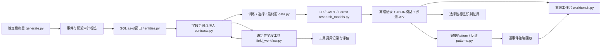

# Risk Decision Lab

**An independently implemented risk decision research lab — synthetic evidence, reproducible experiments, explicit limits.**

长期使命：在不能带走企业数据、代码和项目成果的前提下，将允许公开的通用技术能力转化为独立实验，展示风险分析、机器学习、Pattern研究、策略模拟、字段治理和工具工程能力。完成一个版本或 N6—N10 不是完成这一使命；成长依据是新的可验证能力及对失败的理解。

当前版本 **0.3.0rc1 / Release Candidate**。独立模拟数据和代码；不含企业资料。正式公开仓库：[risk-decision-lab](https://github.com/ArchimeDAs0612/risk-decision-lab) · **[在线静态 Demo](https://archimedas0612.github.io/risk-decision-lab/)** · [公开交付记录](docs/PUBLICATION_STATUS.md)。

[](https://github.com/ArchimeDAs0612/risk-decision-lab/actions/workflows/check.yml)AI 协助开发，本人的独立掌握仍需练习确认。

**直接演示：** [真实研究入口](demo/index.html) · [交互研究工作台](artifacts/rc1/research/normal/index.html) · [选择性标签实验](artifacts/rc1/label-visibility/index.html) · [审计与修复](docs/RC1_AUDIT.md) · [5分钟技术演示](docs/INTERVIEW_GUIDE.md)。在线Demo可直接操作；GitHub文件源码预览不会执行HTML。克隆或下载后也可离线打开，核心演示无需外部服务。

## 已验证能力与边界

| 能力 | 已实现与实际证据 | 仍不能声称 |
| --- | --- | --- |
| 数据工程 | 多事件订单、账户/设备/工具关系；SQLite 1h/24h/7d as-of 窗口；异常准入和案例画像 | 企业数据代表性、真实拒付标签 |
| 模型 | LR、CART、同容量森林；15种输入比较；train/select/final隔离；保存JSON模型并独立推理 | 随机种子复现等同真实域泛化；消融等同因果贡献 |
| Pattern | 完整叶路径、冻结候选、float32逐成员回放、独立后续窗、反证和失败保留 | 稳定发现、生产规则有效性、重新挑测试最佳候选 |
| 策略 | AND/OR/审核/拒绝逐事件动作模拟与成本算术 | 真实业务收益、行为响应、因果收益 |
| 字段与工具 | 禁用/冲突/版本/证据漂移传播；真实工具调用摘要链；未知工具失败恢复与评估 | LLM Agent、自主语言规划、已认证审核身份 |
| 复现与展示 | 离线交互；新虚拟环境与安装包在源码外执行；独立指标与回放复算 | 未运行的操作系统或远程CI也通过 |

## 实际架构



图中每个节点对应实际模块与保存产物，不包含规划中的服务。

## 一个真实案例

预先登记 [RC1研究设计](docs/RC1_STUDY_PLAN.json)，修正物理设备年龄一致性后，主实验仍为 7000订单、9577次尝试，训练/选择/最终为 5133/1364/1968。最终窗有162个风险标签。原V0.2结果保留为历史，不与新生成机制混作一次实验。

| 主实验模型 | 最终 AP | ROC-AUC | KS | Lift@10% |
| --- | ---: | ---: | ---: | ---: |
| Score LR | 0.1298 | 0.6107 | 0.2006 | 1.4800 |
| Raw LR | 0.1654 | 0.6909 | 0.3114 | 2.5833 |
| Raw forest（选择窗选中） | 0.2044 | 0.6911 | 0.3001 | 3.3299 |

选中森林相对Score LR的最终AP差为0.0747，用户簇区间[0.0297,0.1315]。这是此模拟器后续时间窗中的证据。另两个预登记种子选中不同模型，不能据最终AP重新选择主模型。**同容量新增特征森林相对Raw forest的AP差为−0.0276，未证明新增字段改善。** 15模型的探索性区间没有提供整体多重检验校正。

冻结候选 `raw_tree:11` 完整条件绑定训练填补、缺失指示和float32域：`device_age_days > 0.43503323197364807` AND `device_age_days <= 10.210319519042969` AND `geo_distance > 0.13304689526557922` AND `auth_strength > 0.5`。最终90次覆盖、18个风险、风险率20%；相对其余事件的差值区间[0.0127,0.1985]，仅支持调查。三个训练重采样重新发现的Jaccard均为0，**不能声称Pattern稳定**。种子20261018的冻结候选独立验证失败，保留 `INSUFFICIENT_SUPPORT`。

OR拒绝回放使模拟拒绝从9变为99，额外拒绝72个风险零事件；模型化成本9002.63→8122.62依赖拒绝防止全部风险金额损失等强假设，不是业务收益。仅观察成功支付时，全部尝试的Recall只能识别在[0.1500,0.4103]；子集Recall 0.3285不能直接替代它。[完整结果与失败案例](docs/RC1_RESULTS.md)。

## 从源码复现

本地实测CPython3.9.6 / macOS arm64，真实GitHub Actions另验收Ubuntu24.04的Python3.9与3.11。其他环境及跨平台逐比特一致性未声称。免费依赖安装后，实验和工作台可离线运行。

```sh
python3 -m venv .venv
.venv/bin/python -m pip install -r requirements-lock.txt
.venv/bin/python -m pip install .
.venv/bin/python -W error -m unittest discover -s tests -v
.venv/bin/python -W error -m risklab generate --out runs/data
.venv/bin/python -W error -m risklab run --data runs/data --out runs/legacy
.venv/bin/python -W error -m risklab research-demo --out runs/research
.venv/bin/python scripts/verify_v02.py runs/research/normal
.venv/bin/python -m risklab label-study --data runs/research/normal --out runs/visibility
.venv/bin/python -m risklab field-workflow --data runs/research/normal --out runs/field-tools
.venv/bin/python -m risklab predict --model runs/research/normal/models/raw_forest.json --data runs/research/normal/samples.csv --out runs/inference
```

输出目录必须不存在或为空。自行打开 `runs/research/normal/index.html`；11个正常、异常和修复分支索引为 `runs/research/index.html`。安装包包含默认配置、SQL和工作台资源，在源码目录之外也可使用默认命令。[真实复现记录](docs/RC1_REPRODUCTION.json)。

字段工具另提供 `field-inventory`、`field-change`、`field-review`；新释义保持待人工审核。已保存的JSON模型仅支持本Lab的二分类LR/CART/森林，不是通用模型格式，不执行pickle。`predict`不代表线上模型服务或字段治理授权。

## 方法、练习与长期演进

[技术追问与本人练习](docs/INTERVIEW_GUIDE.md) · [详细方法](docs/RC1_METHODS.md) · [当前检查点](CHECKPOINT.md) · [测试与验证](docs/RC1_VERIFICATION.json) · [版本记录](CHANGELOG.md) · [许可](docs/licenses.md) · [GitHub-First长期规范](docs/GITHUB_FIRST.md)。

未来优先研究选择性标签下的训练偏差、时间滚动与外部验证、稳定Pattern选择，以及在明确授权的模型环境中开展真实LLM工具调用和评估。新实习Phase或Owner经历只提炼允许公开的通用技术：抽象→独立实现→实际实验→验证→发布准备；禁止复制企业项目。

MIT覆盖本项目独立代码与合成数据；第三方依赖分别保留其许可。本轮不以测试数量证明成熟度；本人的能力须通过独立解释、修改和故障定位验证。小时检查任务已暂停，自动写入式续跑未启用，不属于算法能力证据。
